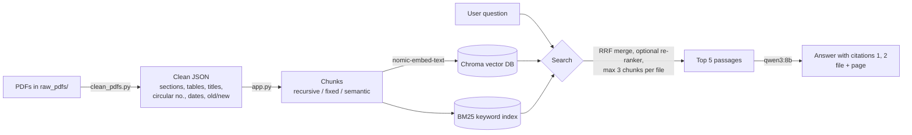

# RBI Circulars RAG Chatbot

Ask questions about RBI circulars, directions and FAQs. Answers come **only** from the PDFs, with a
citation ([1], [2]) and the file + page of every source. Old (withdrawn / superseded) circulars are
hidden unless the question asks for them.

Everything runs **locally** with Ollama: search model `nomic-embed-text`, chat model `qwen3:8b`
("thinking" switched off). No API key, and no question or document leaves the PC.

## Demo

▶ **Video:** [Watch the demo](Demo/demo.mp4)

<!-- Optional: a GIF of the chat -->
<!--  -->

## How it works



1. **Clean** (`clean_pdfs.py`): every PDF becomes sections (headings, tables as sentences,
   footnotes), with its title, circular number, issue date, latest "Updated as on" date, document
   type, and whether it is an old version (a "Withdrawn" stamp, or another circular that supersedes
   it by exact circular number).
2. **Chunk** (`app.py`): sections are cut into chunks of about 1,000 characters. Each chunk keeps its
   file, pages and heading. There is one database per chunking strategy.
3. **Search**: vector search (meaning) + BM25 (exact words and circular numbers), merged with
   Reciprocal Rank Fusion. Optional cross-encoder re-ranker and query rewriting. Follow-up questions
   are rewritten from the last 3 turns.
4. **Answer**: the model answers ONLY from the 5 passages and cites them. When it cannot find the
   answer it says "I could not find this in the documents" and shows no sources.

## Files

| File | What it does |
|---|---|
| `clean_pdfs.py` | PDFs in `raw_pdfs/` -> clean JSON in `output/json/` |
| `app.py` | JSON -> chunks -> vector databases in `vector_db/`; retrieval and answers |
| `streamlit_app.py` | Chat UI (only opens the databases, never builds them) |
| `eval.py` | Retrieval and answer evaluation, baseline, report |
| `check_corpus.py` | Chunks per file / type, short chunks, long headings, wrong titles; writes `corpus_report.md` (title, type, circular no., dates, old/current of every document) |
| `qa_test_set.csv` | Main test set: 40 answerable + 10 out-of-scope questions |
| `qa_heldout.csv` | Held-out test set: 16 answerable + 4 out-of-scope questions, never used for tuning |
| `qa_refusal_check.csv` | Quick check (about 15 minutes): the 14 out-of-scope questions of both sets + 7 answerable ones, to see that the bot refuses what it should and nothing else |
| `qa_old_wording.csv` | The 6 withdrawn-circular questions in plain wording (no "withdrawn"), for the old-version fallback |
| `check_lost_docs.py` | For every PDF: skipped? JSON? type, old/current, words, chunks in the database; writes `lost_docs_report.txt` |
| `tests/test_logic.py` | 58 fast tests of the logic (no Ollama needed) |
| `rename_pdfs.py` | Gives the PDFs in `raw_pdfs/` clear file names (shown to users as the source) |
| `eval_report.md` | The evaluation report (made by `python eval.py --report`) |
| `test_result/` | Every result CSV (latest): `eval_results.csv` (one row per run), `eval_details_*.csv` (every question), `manual_grades_*.csv` (hand grades). `test_result/old/<date_time>/` keeps the earlier version of every file that a new run replaced |
| `requirements.txt` | Python libraries |
| `requirements-ragas.txt` | Extra libraries for the RAGAS evaluation (separate venv) |

## Setup (one time)

Tested with **Python 3.12** on Windows 11.

1. Install Ollama (https://ollama.com), then download the two models:
   ```
   ollama pull nomic-embed-text
   ollama pull qwen3:8b
   ```
2. Python libraries:
   ```
   py -3.12 -m venv .venv
   .venv\Scripts\activate          (Windows)   |   source .venv/bin/activate   (Linux/Mac)
   python -m pip install -r requirements.txt
   ```
3. Put the PDFs in `raw_pdfs/` (they are not in the repository).
4. OCR (optional, for scanned pages): see [OCR setup](#ocr-setup-scanned-pages).

> On a company PC where Device Guard blocks `.exe` files inside `.venv`, start every tool through
> Python: `python -m pip`, `python -m streamlit`, `python -m pytest`.

## Run

```
python clean_pdfs.py                          # 1. PDF -> clean JSON (only new / changed PDFs)
python app.py                                 # 2. build all 3 databases (semantic is slow: do not stop it)
python check_corpus.py                        # 3. check the corpus (files, types, short chunks, titles)
python -m streamlit run streamlit_app.py      # 4. chat at http://localhost:8501
python -m pytest tests -q                     #    logic tests (no Ollama needed)
```
One strategy only: `python app.py --strategy=recursive`. Full rebuild: `python app.py --rebuild`.
Clean all PDFs again: `python clean_pdfs.py --force`.

### Sidebar options

- **Chunking strategy**: which database to search (only the built ones are listed)
- **Hybrid search** (on by default): vectors + BM25 (exact words, circular numbers)
- **Re-ranker**: re-orders the 20 candidates with a cross-encoder (downloads ~90 MB the first time)
- **Query rewriting**: turns short / unclear questions into a clear search query
- **Show retrieved text**: shows the chunk text behind each source

Each browser tab keeps its own settings.

## Test sets

Tab-separated: `id | question | expected_answer | source_doc_id | file_name | page | answer_type | notes`

- `page` can be `2, 5`: a hit if any of these pages is retrieved.
- `answer_type = no_answer`: out of scope; the bot must answer "I could not find this in the documents".
- `source_doc_id` = the PDF's content fingerprint (first 12 characters of its SHA-256). It does not
  change when a PDF is renamed. `python eval.py --ids` lists them.
- Edit the files in Notepad / VS Code, **not Excel** ("Save as CSV" in Excel breaks them; eval.py
  stops and says so).

**`qa_test_set.csv`** (50): 27 paragraph, 6 list, 5 table and 2 multi-section questions, plus 10
`no_answer` questions: 3 off-topic, 2 plausible-but-absent banking topics and 5 near-misses (the topic
is in the documents but the number asked for is not). Several questions ask about near-identical
documents (the Internal Ombudsman directions for Payments Banks / Commercial Banks / CIC) in other
words than the PDF. Six questions are about withdrawn circulars and say so ("Under the withdrawn ..."),
to test the old-version filter.

**`qa_old_wording.csv`** (6): the same six questions in the words a real user would use, without
"withdrawn". Only a withdrawn document answers them, so the bot must fall back to it and say that it
is an old version (see [Documents and versions](#documents-and-versions)).

**`qa_heldout.csv`** (20): 11 paragraph, 4 list and 1 multi-section question plus 4 `no_answer`.
Written after all tuning, only on documents and facts the main set does not use (Small Finance Bank,
NBFC and CIC directions, policy rates, deposits, bulletin, LAB and RRB KYC directions), and never used
to change any setting.

## Evaluation

Run these in order (in the project folder, with `.venv` active):

```
# 1. Checks
python -m pytest tests -q
python check_lost_docs.py
python check_corpus.py

# 2. The floor: plain BM25 over whole pages (seconds)
python eval.py --bm25-pages
python eval.py --bm25-pages --test=qa_heldout.csv

# 3. All setups, retrieval only (no answers, about 20 minutes)
python app.py --strategy=semantic
python eval.py --all --setups --retrieval-only
python eval.py --all --setups --retrieval-only --test=qa_heldout.csv

# 4. With answers (slow: about 35-70 s per question)
python eval.py --strategy=recursive
python eval.py --strategy=recursive --test=qa_heldout.csv

python eval.py --strategy=recursive --hybrid
python eval.py --strategy=recursive --hybrid --test=qa_heldout.csv

python eval.py --strategy=recursive --hybrid --test=qa_old_wording.csv

python eval.py --strategy=recursive --hybrid --rerank
python eval.py --strategy=recursive --hybrid --rerank --test=qa_heldout.csv

# 5. Hand-grade the answers that have no numbers (y / p / n)
python eval.py --grade --strategy=recursive --hybrid
python eval.py --grade --strategy=recursive --hybrid --test=qa_heldout.csv

# 6. Report: eval_report.md + the results table below
python eval.py --report
```

- **Same k for every setup** (Hit@1, Hit@3, Hit@5, MRR@5). The bot answers from 5 passages.
- **Hit** = the right document AND one of the expected pages is in the top k.
- **Key facts** = share of the numbers (also written as words: "three" = 3), amounts, dates and e-mail
  addresses of the expected answer that appear in the bot's answer. Answers without any number
  (yes / no, lists, names) are **graded by hand** once with `--grade` (y / partly / n), and the
  grades are shown in `eval_report.md`.
- **Answered a miss** = answerable questions where the search did not find the right document but the
  bot answered anyway (a fluent answer from the wrong passages). It should be 0; prompt rule 11 makes
  the model check that a passage really answers the question.
- **No-answer refused** = share of out-of-scope questions where the bot correctly said it could not
  find the answer.
- **Cut-off advice:** each run suggests a `MIN_RELEVANCE` from the dev half of the questions and
  checks it on the other half; the advice is saved in `eval_results.csv` and shown in the report.
- **The BM25 floor** stops with an error when PDFs that `clean_pdfs.py` indexed are missing from
  `raw_pdfs/`, so a floor on a few PDFs can never be published again.
- Every run adds a row with all its settings to `test_result/eval_results.csv` and writes
  `test_result/eval_details_<test>_<setup>.csv` (every question: hit or miss, rank, the bot's answer).
- **Faithfulness and answer relevance (RAGAS):** add `--ragas` to a run (see below).
- **All setups and the ablation** (`--all --setups`): recursive / fixed / semantic chunking ×
  (vectors, + hybrid, + re-ranker, + query rewriting), plus recursive + hybrid without DOC_FOCUS,
  without stemming and with synonyms. Run with `--retrieval-only`, because answering every setup
  would take about 22 hours on a CPU (15 setups × 70 questions × ~35 s). Retrieval-only rows are
  marked "(retrieval only)" in the tables and never replace a run with answers.

### RAGAS: faithfulness and answer relevance

- **Faithfulness**: is every claim in the answer supported by the 5 retrieved passages? (0 to 1)
- **Answer relevance**: does the answer address the question? (0 to 1)

RAGAS needs the `datasets` library, which upgrades `huggingface_hub` and breaks
`sentence-transformers` (the re-ranker) in the main venv. So it runs in a **separate venv**:

```
py -3.12 -m venv .venv-ragas
.venv-ragas\Scripts\activate
python -m pip install -r requirements-ragas.txt

python eval.py --strategy=recursive --hybrid --ragas
python eval.py --strategy=recursive --hybrid --ragas --test=qa_heldout.csv
python eval.py --report
```

RAGAS is graded by the same local model (`qwen3:8b`), so the scores are rough, not a strong judge.
It is slow on a CPU: several model calls per question (about 1–2 hours for the main set). The scores
are saved in `eval_results.csv`, per question in `eval_details_*.csv`, and shown in the table below.

### Results

Scored at k = 5. Model: `qwen3:8b` on a laptop CPU, about 35 seconds per answer.


| Test set | Setup | Hit@1 | Hit@3 | Hit@5 | MRR@5 | Key facts | No-answer refused | Answered a miss | Faithfulness | Answer relevance |
|---|---|---|---|---|---|---|---|---|---|---|
| qa_test_set.csv | `bm25-pages` | 0.650 | 0.850 | 0.875 | 0.751 |  |  |  |  |  |
| qa_test_set.csv | `fixed` (retrieval only) | 0.725 | 0.875 | 0.950 | 0.804 |  |  |  |  |  |
| qa_test_set.csv | `fixed+hybrid` (retrieval only) | 0.775 | 0.925 | 1.000 | 0.852 |  |  |  |  |  |
| qa_test_set.csv | `fixed+hybrid+rerank` (retrieval only) | 0.875 | 0.975 | 0.975 | 0.925 |  |  |  |  |  |
| qa_test_set.csv | `fixed+hybrid+rerank+rewrite` (retrieval only) | 0.900 | 0.950 | 0.950 | 0.925 |  |  |  |  |  |
| qa_test_set.csv | `recursive` (retrieval only) | 0.775 | 0.925 | 0.950 | 0.847 |  |  |  |  |  |
| qa_test_set.csv | `recursive+hybrid` (retrieval only) | 0.800 | 0.950 | 0.975 | 0.873 |  |  |  |  |  |
| qa_test_set.csv | `recursive+hybrid+rerank` (retrieval only) | 0.850 | 1.000 | 1.000 | 0.917 |  |  |  |  |  |
| qa_test_set.csv | `recursive+hybrid+rerank+rewrite` (retrieval only) | 0.875 | 1.000 | 1.000 | 0.925 |  |  |  |  |  |
| qa_test_set.csv | `recursive+hybrid+synonyms` (retrieval only) | 0.850 | 0.975 | 1.000 | 0.906 |  |  |  |  |  |
| qa_test_set.csv | `recursive+hybrid-docfocus` (retrieval only) | 0.825 | 1.000 | 1.000 | 0.904 |  |  |  |  |  |
| qa_test_set.csv | `recursive+hybrid-stemming` (retrieval only) | 0.825 | 0.950 | 0.950 | 0.887 |  |  |  |  |  |
| qa_test_set.csv | `semantic` (retrieval only) | 0.725 | 0.825 | 0.875 | 0.783 |  |  |  |  |  |
| qa_test_set.csv | `semantic+hybrid` (retrieval only) | 0.725 | 0.900 | 0.975 | 0.827 |  |  |  |  |  |
| qa_test_set.csv | `semantic+hybrid+rerank` (retrieval only) | 0.850 | 0.950 | 0.950 | 0.896 |  |  |  |  |  |
| qa_test_set.csv | `semantic+hybrid+rerank+rewrite` (retrieval only) | 0.850 | 0.950 | 0.950 | 0.892 |  |  |  |  |  |
| qa_heldout.csv | `bm25-pages` | 0.438 | 0.812 | 0.875 | 0.630 |  |  |  |  |  |
| qa_heldout.csv | `fixed` (retrieval only) | 0.688 | 0.812 | 0.812 | 0.750 |  |  |  |  |  |
| qa_heldout.csv | `fixed+hybrid` (retrieval only) | 0.750 | 0.875 | 0.875 | 0.802 |  |  |  |  |  |
| qa_heldout.csv | `fixed+hybrid+rerank` (retrieval only) | 0.688 | 0.875 | 0.875 | 0.771 |  |  |  |  |  |
| qa_heldout.csv | `recursive` (retrieval only) | 0.625 | 0.875 | 0.875 | 0.740 |  |  |  |  |  |
| qa_heldout.csv | `recursive+hybrid` (retrieval only) | 0.625 | 0.812 | 0.812 | 0.719 |  |  |  |  |  |
| qa_heldout.csv | `recursive+hybrid+rerank` (retrieval only) | 0.625 | 0.938 | 0.938 | 0.760 |  |  |  |  |  |
| qa_heldout.csv | `recursive+hybrid+rerank+rewrite` (retrieval only) | 0.625 | 0.750 | 0.812 | 0.703 |  |  |  |  |  |
<!-- RESULTS:END -->

Full table with per-question wins and losses: [eval_report.md](eval_report.md).

**What the numbers say**

Database: 34 PDFs, 2,914 chunks (recursive). Floor: plain BM25 over all 1,136 pages of the same PDFs.

1. **Main set (40 answerable):** every chunked setup beats the floor. Floor Hit@5 0.875 / MRR@5
   0.751; `recursive` 0.950 / 0.847; `recursive+hybrid` 0.975 / 0.873; `recursive+hybrid+rerank`
   1.000 / 0.917. This is the set the pipeline was tuned on.
2. **Held-out set (16 answerable, never used for tuning):** every setup ranks the right page first
   more often than the floor (Hit@1 0.625-0.750 against 0.438) and has a higher MRR@5 (0.703-0.802
   against 0.630). At Hit@5 the floor (0.875) equals `recursive` and `fixed+hybrid`, is beaten
   only by `recursive+hybrid+rerank` (0.938), and is better than `recursive+hybrid` (0.812). Five
   whole pages hold about three times as much text as five chunks, so the floor is generous at Hit@5.
3. **Hybrid search** helps on the main set (+1, q027) and with `fixed` chunks (+2 main, +1
   held-out), but loses h03 on the held-out set with `recursive`. With 16 questions one question is
   6.25 points: no clear win either way.
4. **Re-ranker:** the best Hit@5 on both sets (1.000 main, 0.938 held-out, +h15) for 2-3 seconds
   per question. Whether it becomes the default depends on the refusal rate in the answer runs
   (step 4 above): an earlier run showed it refusing fewer out-of-scope questions.
5. **Query rewriting** does not pay off: it loses h03 and h05 on the held-out set (Hit@5 0.812)
   and costs 10-20 seconds per question.
6. **Ablation (main set, `recursive+hybrid`):** without stemming Hit@5 drops to 0.950 (loses q015),
   so stemming stays on. Synonyms (1.000) and switching DOC_FOCUS off (1.000) each win one question
   (q012); one question is too little to change the default.
7. **Cut-off:** no clean `MIN_RELEVANCE` exists (out-of-scope questions score up to 0.81, real
   ones as low as 0.76-0.79), so it stays 0 and the model decides when to refuse.

**Where it still fails**

- **Right document, wrong page** in long, near-identical documents: h03 (Small Finance Bank
  ombudsman tenure) with hybrid search, h05 with query rewriting.
- **Different words in the question and the PDF:** q012 asks for a "penalty"; the PDF says "fine".
  Found only with the re-ranker, synonyms or without DOC_FOCUS.
- **Fixed: two documents were missing from the database** used for the earlier runs: the BEAWARE
  fraud booklet (q016, q017, h15) and the Local Area Bank directions (q026, h13). The booklet took
  longer than the 1,000-second limit in `clean_pdfs.py`, so it was skipped. After cleaning again and
  rebuilding, the database grew from 2,617 to 2,914 chunks (61 booklet + 236 LAB chunks,
  `check_lost_docs.py`). The limit is now 3,000 seconds, and every timed-out file is printed by name.
- **Answers from the wrong passages** (q016 answered from an e-Rupee passage, q047 given the
  commercial-bank capital ratio): prompt rule 11 and the "Answered a miss" count address this.

**With another week**

A larger held-out set written by someone else, scoring by section instead of page, an LLM judge for
answer correctness on a sample, and the full answer evaluation of every setup on a faster machine.

## Documents and versions

`clean_pdfs.py` types each document from page 1: `annual_report`, `faq`, `rbi_circular`, `manual` or
`general`. Only `rbi_circular` needs a circular number and issue date (warnings are printed when they
are missing). Consolidated master directions also get `updated_on` (the latest "Updated as on" date),
and the model is told to prefer the most recent document.

A circular is **old** (`is_latest = false`) when it carries a "Withdrawn" / "Superseded" stamp, or when
another circular supersedes it by **exact** circular number or by a dated reference. Old circulars are
searched only when the question names a circular number, a year with "circular / direction", or asks
for a withdrawn / superseded / earlier circular. A bare "withdrawn" ("Is the Rs 2000 note withdrawn?")
does not count.

**Fallback (`OLD_FALLBACK = True`):** when no current document answers a question, the bot searches
once more WITH old documents. The second answer is kept only if it **cites** an old passage (otherwise
the bot says it could not find the answer); it then starts with "Note: this answer comes from an OLD
document" and the chat shows a warning. Questions in the
plain wording of `qa_old_wording.csv` test this.

Annual reports of banks and their financial results are left out of the index
(`INCLUDE_ANNUAL_REPORTS = False`). RBI's own Annual Report chapter is kept (decided from the cover
page, not the file name).

## Adding or renaming PDFs

1. Copy the new PDFs into `raw_pdfs/` with a clear file name (the file name is shown to users as the
   source).
2. `python clean_pdfs.py`, then `python app.py` (it sees the change and rebuilds).
3. Restart Streamlit. The test sets keep working after renames (`source_doc_id`).

## OCR setup (scanned pages)

Some PDFs have scanned pages (pictures of text). `clean_pdfs.py` reads them with **OCRmyPDF**, which
needs **Tesseract** (reads the text) and **Ghostscript** (rewrites the PDF). Without them those pages
stay empty and `clean_pdfs.py` prints `WARNING: pages [...] need OCR - missing: ...`.

**Windows**
1. Tesseract: install from https://github.com/UB-Mannheim/tesseract/wiki
   (tick "Add to PATH", or add `C:\Program Files\Tesseract-OCR` to PATH yourself).
2. Ghostscript: install the 64-bit "AGPL release" from https://ghostscript.com/releases/gsdnld.html
   (adds `gswin64c`; if not found, add `C:\Program Files\gs\gs10.xx\bin` to PATH).
3. In the venv: `python -m pip install ocrmypdf`
4. Close and reopen the terminal.

**Ubuntu / Debian:** `sudo apt install ocrmypdf tesseract-ocr ghostscript`
**macOS:** `brew install ocrmypdf`

Check: `tesseract --version`, `gswin64c --version` (Windows) or `gs --version`, `ocrmypdf --version`.
Then clean the PDFs again: `python clean_pdfs.py --force`

## Deployment

The chatbot runs **locally only**. It needs Ollama with `qwen3:8b` (about 5 GB) and
`nomic-embed-text`, and free hosting services do not offer a machine that can run them. To show it
to others, run it on your PC (`python -m streamlit run streamlit_app.py`) or watch the
[demo video](#demo).

## Do not commit

`raw_pdfs/`, `vector_db/`, `output/`, `.venv/`, `.env` (all in `.gitignore`).
**Do commit** `qa_test_set.csv`, `qa_heldout.csv`, `qa_old_wording.csv`, the `test_result/` folder,
`eval_report.md` and `corpus_report.md`, so others can check and reproduce the evaluation.